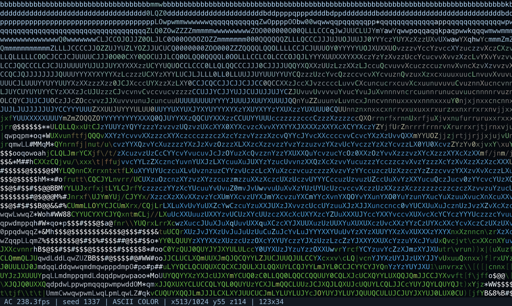
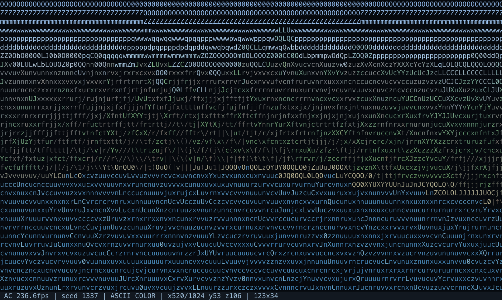
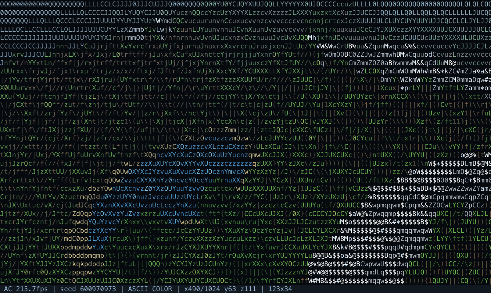

<div align="center">

# ASCIICRAFT

### ASCII Minecraft in your terminal.

A procedural mc-like world - hills, lakes, caves, forests and snow - raycast into
**colored characters**. No GPU, no textures, no game engine, no dependencies.

[](https://www.python.org/)
[](pyproject.toml)
[](LICENSE)
[](https://lewodro.github.io/asciicraft/)

**[Play in the browser](https://lewodro.github.io/asciicraft/)** ·
[Quick start](#quick-start) · [Screenshots](#screenshots) · [How it works](#how-it-works)

</div>

<a href="https://lewodro.github.io/asciicraft/">
  
</a>

<p align="center"><em>Seed 1337 · 123 × 34 character cells · ascii-color mode</em></p>

## What is this?

ASCIICRAFT is a small digital-art experiment: a 1024 × 256 × 80 voxel world
(21 million cells) rendered entirely as text. Every character cell fires one ray
into the terrain; the surface colour is reduced to a glyph and a foreground
colour, then streamed to your terminal.

The result is a world you can fly through in real time, made of nothing but
printable characters and ANSI colour codes.

- **21 million voxels** generated from a single seed
- **About five minutes** to walk across at walking speed
- Hills, lakes, beaches, caves, forests and snow-capped ridges, split into
  plains, forest, savanna and desert biomes
- Cabins and ruins to find, with cacti in the dunes
- Truecolor ASCII with directional face lighting, ambient occlusion, procedural
  grain, animated water and distance fog
- Terminal build in **pure Python** (standard library only) and a matching
  **browser build** in two static files
- Fork-parallel renderer: ~75 FPS at 160 × 48 characters on a laptop

## Quick start

### Terminal

```bash
git clone https://github.com/lewodro/asciicraft.git
cd asciicraft
./run.sh
```

Requires Python **3.9+** on macOS, Linux or WSL. The first launch generates the
full world in about a second, then opens the view. Press **Q** to quit.

```bash
./run.sh --small          # 256 × 128 × 80 world, generates in a fraction of a second
./run.sh --seed 42        # choose a world
./run.sh --look 0.7       # calmer look speed
python3 -m voxelterm      # module entry point
pip install -e .          # optional install, then run `asciicraft`
```

Native Windows does not provide `termios`; use **WSL** for the terminal build,
or use the browser build.

### Browser

**[lewodro.github.io/asciicraft](https://lewodro.github.io/asciicraft/)** — no
install, no build step. To run it locally:

```bash
./serve.sh
# http://localhost:8000/web/
```

You can also open `web/index.html` directly from disk. Windows users can run
`serve.bat`. The intro card stays up long enough to read the controls before the
world starts moving.

## Screenshots

<table>
<tr>
<td width="50%">

<p><em>Seed 1337 · valley floor · ascii-color</em></p>
</td>
<td width="50%">

<p><em>Seed 600970973 · snow line · ascii-color</em></p>
</td>
</tr>
</table>

All captures are real frames from the renderer. The commands used to reproduce
them are in [`assets/README.md`](assets/README.md).

## Controls

| Key | Action |
| --- | --- |
| `W` `A` `S` `D` | move horizontally |
| `←` `→` | look left / right |
| `↑` `↓` | look up / down |
| `Space` | fly up |
| `C` or `X` | fly down |
| `E` | sprint (1.8×) |
| `M` | cycle `ascii-color → half → ascii-mono` |
| `R` | generate a new random world |
| `[` `]` | lower / raise render quality |
| `Q`, `Esc` | quit |

The status line reports the biome under the camera and your height above local
ground, names the nearest cabin or ruin with a distance and compass letter, and
counts the sites you have reached (`sites 3/12`). Walking within 14 metres of a
landmark marks it as explored for the current seed.

Terminals cannot report a bare Shift key, so `C`/`X` is the portable descend
key and `E` is hold-to-sprint.

Web controls are the same, with mouse drag or arrow keys to look. `Q`/`Esc`
pauses and reveals the seed box.

### Look sensitivity

The default is tuned to be comfortable. Scale it with `--look` in the terminal
or `?look=` in the browser:

```bash
./run.sh --look 0.7
```

```
https://lewodro.github.io/asciicraft/?look=0.7
```

`--look` accepts `0.2`–`3.0`; values outside that range are clamped.

## How the ASCII rendering works

Each character cell gets one ray. On a hit, the shader produces an RGB colour,
which is converted to a glyph plus a foreground colour:

```python
lum  = (0.2126*R + 0.7152*G + 0.0722*B) / 255   # Rec. 709 luminance
tone = lum ** 0.72                              # lift the mid-tones
idx  = int(tone * (len(RAMP) - 1) + 0.5)        # pick a glyph
fg   = (min(255, int(R*1.14 + 10)), ...)        # lift for legibility
```

The ramp has 70 glyphs, from space to `$`:

```text
 .'`^",:;Il!i><~+_-?][}{1)(|\/tfjrxnuvczXYUJCLQ0OZmwqpdbkhao*#MW&8%B@$
```

Brightness chooses the character; colour is carried separately by the ANSI
foreground. Six face directions get different light levels so cubes still read
as cubes, a hash-based material shader adds grass, stone, wood and snow texture,
and distance fades into the sky gradient.

**Read the full pipeline, with exact constants and worked examples:
[`docs/ascii-rendering.md`](docs/ascii-rendering.md).**

### Modes

| Mode | What it does |
| --- | --- |
| `ascii-color` | 70-glyph ramp + truecolor foreground (default) |
| `half` | `▀` with independent top/bottom colours, 2× vertical detail |
| `ascii-mono` | same glyphs, one grey value per cell |

Press **M** to cycle modes live.

## Performance

Measured on an arm64 macOS laptop with 6 forked workers, 160 × 48 character
cells, after world generation:

| Mode | Pixels | FPS |
| --- | --- | --- |
| `ascii-color` | 160 × 48 | ≈ 75 |
| `half` | 160 × 96 | ≈ 40 |

Full Python world generation takes ≈ 1.2 s on the same machine; the small world
takes < 0.3 s. Height-field columns and cave stamps are split across forked
workers, so the voxels are identical to a serial build (set
`VOXELTERM_GEN_WORKERS=1` to force it). The renderer interleaves scanlines
across workers, giving every worker a similar mix of sky and foreground, and
falls back to serial mode where `fork` is unavailable (`--serial` forces this).

## CLI options

```text
--seed N             world seed (default 1337)
--mode MODE          ascii-color (default) | half | ascii-mono
--fov DEG            horizontal field of view (default 76)
--look SCALE         look sensitivity, 0.2..3.0 (default 1.0)
--width / --height   render size in character cells (0 = terminal size)
--pixels N           approximate ray budget for automatic layout
--workers N          0 = auto, 1 = serial forked renderer
--serial             disable fork-based parallel bands
--no-hud             hide the status line
--world-width/-depth/-height N   custom world size
--small              shorthand for 256 x 128 x 80
--snapshot FILE      render one frame to an ANSI file and exit
--benchmark N        render N frames and report FPS
```

Set `VOXELTERM_GEN_WORKERS=1` to disable fork-parallel world generation.

## Browser build

`web/index.html` + `web/engine.js` are a direct port of the Python engine: the
same MT19937 seeding, Perlin noise, terrain/cave/tree generation, DDA traversal
and shader. The seed lives in the URL, so every view is shareable:

```text
https://lewodro.github.io/asciicraft/?seed=1337
https://lewodro.github.io/asciicraft/?seed=42&mode=ascii-mono
https://lewodro.github.io/asciicraft/?seed=42&fov=90&look=0.7
```

`tools/web_parity.py` verifies that seed 1337 produces an identical voxel grid
in both implementations and that rendered frames agree to ~99% of pixels
(remaining differences are last-bit `sin`/`cos` variations between libms).

To publish your own copy, upload `web/` to any static host. GitHub Pages can
serve the repository root: the root `index.html` redirects to `web/`.

## How it works

**World.** A domain-warped continental fBm plus a ridged mountain mask builds the
height map. Columns are filled with stone, dirt, grass, sand and snow; water
fills to sea level; two intersecting 3D noise isosurfaces carve tunnels and
caverns; a jittered lattice plants trees, and a low-frequency heat/moisture map
selects a biome that tints the grass and controls tree and cactus density.
Cabins and ruins are levelled onto flat dry ground, cave air gets dripstone and
ore. A dense `bytearray` holds the
voxels, an 8³ occupancy array lets the tracer skip empty air, and 16³ chunks are
kept for inspection.

**Tracing.** Each cell gets a ray from an orthonormal camera basis. A coarse DDA
walks 8³ macro cells until it finds an occupied one, then an exact voxel DDA
walks only that segment. Hits return block id, face normal, face UV and distance.

**Compositing.** Face light, AO and fog are applied to the material colour. The
ANSI encoder emits one string per frame, changing colour only when a run ends, so
the terminal never sees a partially painted image and the screen is never cleared
between frames.

## Project layout

```text
asciicraft/
├── main.py                 entry point
├── CONTRIBUTING.md         setup, checks and review expectations
├── CHANGELOG.md            release history
├── voxelterm/              Python engine and terminal app
│   ├── world.py            terrain, biomes, caves, structures
│   ├── raycaster.py        hierarchical voxel DDA + shader
│   ├── ansi.py             70-glyph ramp + ANSI encoder
│   ├── terminal.py         raw terminal + key parser
│   ├── parallel.py         fork-based scanline bands
│   └── app.py              loop, layout, modes, snapshot/benchmark
├── web/                    dependency-free browser port
├── tools/                  preview, PTY, parity, DOM, profiling and screenshot tools
├── assets/                 README screenshots
├── docs/
│   ├── ascii-rendering.md  the full RGB → glyph → ANSI pipeline
│   └── launch-post.md      short launch copy for social posts
├── run.sh / serve.sh       local launchers
└── pyproject.toml          optional packaging
```

## Development checks

```bash
python3 -m py_compile main.py voxelterm/*.py tools/*.py
python3 tools/check_repo.py                                # required files + local links
python3 tools/profile_render.py --small --frames 5         # generation/render/encode timings
python3 tools/pty_test.py --small --width 70 --height 18   # input/quit/mode test
python3 tools/web_parity.py                                # Python ↔ JS parity
jsc tools/web_dom_test.js                                  # browser DOM smoke test
```

The `tools/*.js` files run under the macOS JavaScriptCore shell (`jsc`) and are
development helpers, not required to play. `tools/screenshot.py` uses headless
Chrome to regenerate the README images.

## Notes and limits

- The terminal renderer needs a TrueColor terminal (iTerm2, Terminal.app, most
  modern Linux terminals, Windows Terminal via WSL).
- Interactive mode requires a TTY; use `--snapshot` or `--benchmark` when
  redirecting output.
- There is no persistence or block editing yet — the world is read-only.
- Regenerating a full world takes a few seconds in Python; the browser engine
  generates the same grid in about 0.2 s.

## License

MIT. See [`LICENSE`](LICENSE).

<div align="center">

If this made you smile, **star the repo** and share it with someone who lives in
a terminal.

</div>
